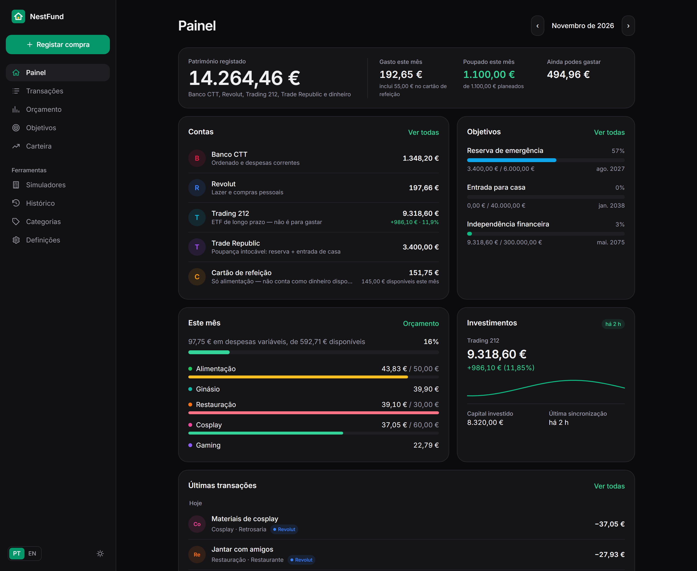
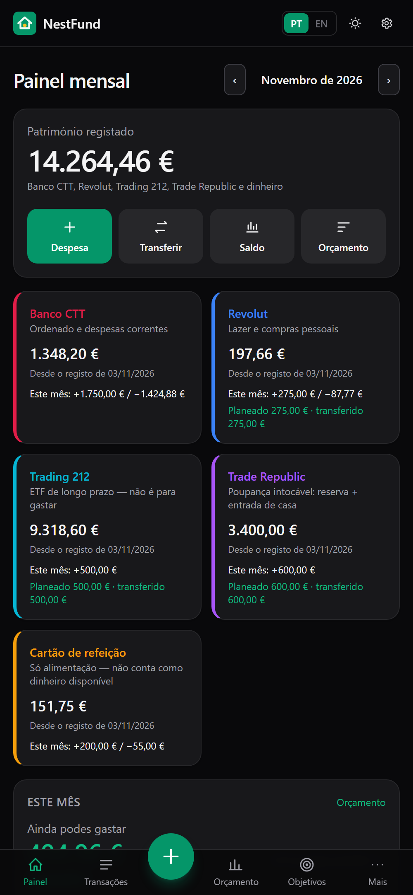
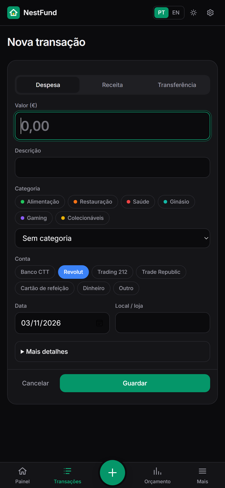
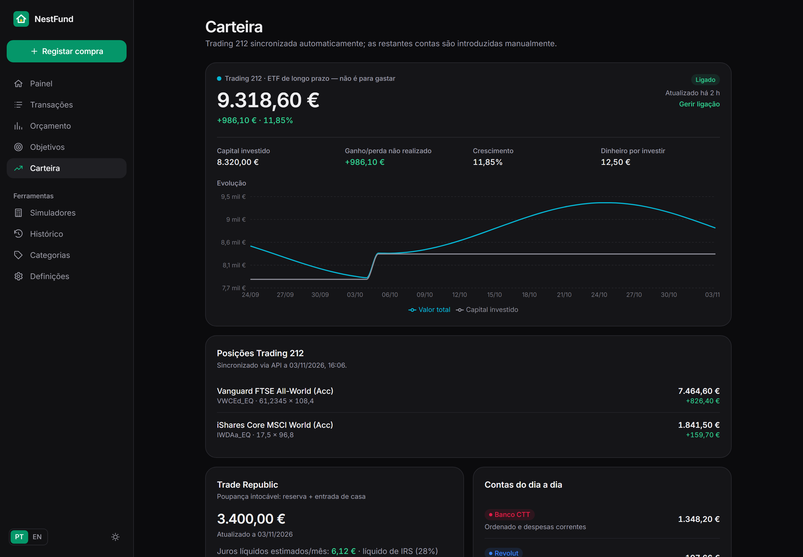

<div align="center">


# NestFund

**Your personal finances in one place — budget, spending, goals and investing.**

[](https://github.com/mwmiao/NestFund/actions/workflows/docker-publish.yml)
[](https://hub.docker.com/r/eazyeight/nestfund)

[🇵🇹 Português](README.md) · 🇺🇸 English



</div>

NestFund is a self-hosted personal finance dashboard. Plan your salary, log every purchase in seconds and track your savings, house down payment and ETF investing — without opening your banking apps. Your data stays on your own server.

## Features

- **Clear dashboard** — total net worth, what you can still spend this month, and quick actions.
- **Purpose-driven accounts** — Banco CTT, Revolut, Trading 212, Trade Republic and a meal card, each with its own balance and activity.
- **Fast logging** — purchase, expense, income or transfer in a few taps, with attachments and recurring entries.
- **Monthly budget** — fixed costs, leisure, ETF and savings, planned vs. actual.
- **Goals** — emergency fund, house down payment and financial independence, with automatic progress.
- **Automatic Trading 212** — value, invested capital and positions synced every 6 hours (read-only).
- **Simulators** — house down payment with tiered interest, net of Portuguese tax; ETF projection.
- **History and CSV** — month-by-month evolution, export and import.
- **Portuguese / English**, dark mode, built for mobile.

<div align="center">
  
  &nbsp;
  
</div>

<p align="center"></p>

> NestFund shows simulations and records — it is not financial advice.

## Install with Docker Compose

```yaml
services:
  nestfund:
    image: eazyeight/nestfund:latest
    container_name: nestfund
    restart: unless-stopped
    ports:
      - "7777:7777"
    environment:
      TZ: Europe/Lisbon
    volumes:
      - nestfund-data:/data
    labels:
      - com.centurylinklabs.watchtower.enable=true

volumes:
  nestfund-data:
```

```bash
docker compose up -d
```

Open `http://<server-ip>:7777` and follow **Setup** to enter your balances, salary, fixed costs and goals. You can skip it and come back later.

Data (SQLite and attachments) lives in the `/data` volume. See [Backup and restore](#backup-and-restore).

## Security

A summary of the protections, limitations and how to expose the app safely is in [SECURITY.md](SECURITY.md) (Portuguese). If the app is reachable from the Internet, turn on `BASIC_AUTH_USER`/`BASIC_AUTH_PASSWORD` or use Cloudflare Access.

## Backup and restore

Everything is in **Settings › Backup and data**.

| You want to… | Do this |
|---|---|
| A copy right now | **Create backup now**. Saves a full copy (`nestfund-backup-….db`) and a portable file (`nestfund-backup-….json`) in `/data/backups/`. Nothing is changed. |
| Export your data | **Export JSON** (complete backup, or just a period) or **Export CSV** (transactions, accounts, balance check-ins, categories, budgets, goals, Trading 212 history). |
| Import | Upload a backup `.json` or a transactions `.csv`. You get a **preview** of what will be created, updated and ignored, and only then confirm. |

Your Trading 212 API key is **never** included in exports. After reconnecting, paste it again in Settings.

### Restore a JSON backup (any installation)

1. Install/open NestFund (it can be empty or already hold data).
2. **Settings › Backup and data › Import** and choose the `.json` file.
3. Review the preview: **Create** (records that do not exist yet), **Update** (categories, goals, budget lines, month budgets and profile that differ; the fields are listed) and **Ignore** (already there).
4. **Confirm import.** Before writing anything, the app saves a full copy to `/data/backups/nestfund-before-import-….db`.

Safety rules: nothing is deleted; existing transactions, balance check-ins, rules and Trading 212 days are never overwritten; importing the same file twice creates no duplicates. Genuine repeated lines (two identical coffees on the same day) are kept, but only as many as are missing.

### Restore a full database copy (`.db`)

Use this to bring back **everything** exactly as it was (including the Trading 212 connection and settings). It replaces the current database.

```bash
docker compose stop nestfund

# 1. keep the current database, just in case
docker run --rm --volumes-from nestfund alpine cp /data/nestfund.db /data/nestfund.db.before-restore

# 2. put the copy back (adjust the file name in /data/backups/)
docker run --rm --volumes-from nestfund alpine sh -c \
  'cp /data/backups/nestfund-backup-YYYY-MM-DDTHH-MM-SS-000Z.db /data/nestfund.db && chown 1000:1000 /data/nestfund.db && rm -f /data/nestfund.db-wal /data/nestfund.db-shm'

docker compose start nestfund
```

Attachments live in `/data/uploads` and are not part of the `.db`; copy that folder separately if you want them. To keep backups off the server, copy `/data/backups/` elsewhere (for example `docker cp nestfund:/data/backups ./backups`).

> Anyone who can reach the app's address can download exports. If you expose it to the Internet, protect it (for example with Cloudflare Access).

## Install as an app (PWA)

NestFund can be added to your home screen and opens full screen, like an app. **It needs HTTPS**: your Cloudflare Tunnel domain (for example `https://nestfund.your-domain.com`) is fine. With `http://<ip>:7777` the iPhone only makes a shortcut, without offline use.

### iPhone / iPad (iOS 16.4 or newer)

1. Open the NestFund address in **Safari**.
2. Tap the **Share** button (the square with an arrow pointing up).
3. Scroll and tap **Add to Home Screen**.
4. Confirm the name (**NestFund**) and tap **Add**.
5. Open NestFund from the new icon. It should open without Safari's toolbar.

> If **Add to Home Screen** is not listed, tap **More** (⋯) in the share sheet. If you use another browser on iPhone, open the address in Safari. Push notifications are not supported; notices appear inside the app (bell icon).

### Android and desktop

- **Android (Chrome):** menu ⋮ › **Install app**, or the **Install NestFund** button in *Settings*.
- **Desktop (Chrome/Edge):** the install icon in the address bar.

### Offline use

After you have opened the overview pages (dashboard, transactions, budget, goals, reports, history, simulators), a copy stays on the device and opens even without a network or with the server switched off, with a notice that it is a saved copy. Changes cannot be saved offline.

For safety the following are **never** stored: settings, backups and imports, notifications, the portfolio and Trading 212 data, attachments, `/api/*` responses and any request that changes data. Saved copies expire after 7 days and at most 24 are kept. Delete them in *Settings › App and offline use › Delete offline data*. Anyone with your unlocked phone can see the saved pages, just as they could see the rest of the app.

### Updates (Watchtower)

When Watchtower updates the container, every release ships a new `sw.js`. The installed app notices it when opened (and hourly while open) and shows **“A new version of NestFund is ready” › Update**; nothing reloads unless you ask, so you never lose what you were typing. On iPhone, if the notice does not appear, close the app completely (swipe it away in the app switcher) and open it again. As a last resort use *Delete offline data* and reopen, or remove the icon and add it again.

The domain and port 7777 do not change. To regenerate the icons after changing the artwork: `npm run icons`.

## Port 7777 and Cloudflare Tunnel

The app listens on port **7777**. To change the host port, edit only the left side: `"8080:7777"`.

> **Upgrading from a version on port 777?** Use `"7777:7777"` and `PORT: 7777` in compose and point the Cloudflare Tunnel at `:7777`. If your compose sets `PORT: 777`, the app keeps using that port until you change it.

To expose it through Cloudflare Tunnel, add a *Public Hostname* (Zero Trust → Networks → Tunnels):

| Field | Value |
|---|---|
| Hostname | `nestfund.your-domain.com` |
| Service | `HTTP` → `<server-ip>:7777` |

The app has no user accounts — protect it with **Cloudflare Access** (a policy that only allows your e-mail). Alternatively, set `BASIC_AUTH_USER` and `BASIC_AUTH_PASSWORD`.

## Connect Trading 212

1. In the Trading 212 app: **Settings › API (Beta)** › generate a key with read-only permissions (*Account data* and *Portfolio*).
2. In NestFund: **Settings › Connections** › paste the API key and secret.

NestFund only reads the account summary and positions — it never places orders. The key is stored encrypted (AES-256-GCM); set `NESTFUND_SECRET` to use your own encryption key. If the connection fails, the app keeps the last values.

## Automatic updates with Watchtower

The `com.centurylinklabs.watchtower.enable=true` label lets Watchtower update the container whenever a new `latest` image is published. Your data is kept and the database is migrated automatically on startup.

## Development

```bash
npm install
npm run dev     # http://localhost:7777
npm test
```

Every push to `main` publishes `eazyeight/nestfund:latest` (amd64 + arm64). A `v1.2.0` tag also publishes `1.2.0`.

## License

Personal project by [@mwmiao](https://github.com/mwmiao). Built with Next.js, Tailwind CSS and SQLite.
