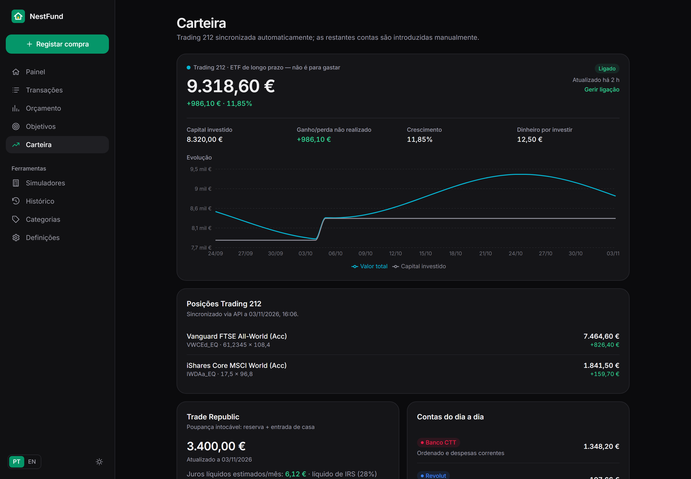

<div align="center">


# NestFund

**As tuas finanças pessoais, num só lugar — orçamento, despesas, objetivos e investimento.**

[](https://github.com/mwmiao/NestFund/actions/workflows/docker-publish.yml)
[](https://hub.docker.com/r/eazyeight/nestfund)

🇵🇹 Português · [🇺🇸 English](README.en-US.md)


</div>

O NestFund é um painel de finanças pessoais self-hosted. Planeia o salário, regista cada compra em segundos e acompanha a poupança, a entrada para casa e o investimento em ETF — sem depender das apps do banco. Os teus dados ficam no teu servidor.

## Funcionalidades

- **Painel claro** — património total, quanto ainda podes gastar este mês e ações rápidas.
- **Contas com propósito** — Banco CTT, Revolut, Trading 212, Trade Republic e cartão de refeição, cada uma com saldo e movimentos.
- **Registo rápido** — compra, despesa, receita ou transferência em poucos toques, com anexos e recorrências.
- **Orçamento mensal** — despesas fixas, lazer, ETF e poupança, planeado vs. real.
- **Objetivos** — reserva de emergência, entrada para casa e independência financeira, com progresso automático.
- **Trading 212 automática** — valor, capital investido e posições sincronizados a cada 6 horas (só leitura).
- **Simuladores** — entrada para casa com TANB escalonada e juros líquidos de IRS; projeção de ETF.
- **Histórico e CSV** — evolução mês a mês, exportação e importação.
- **PT / EN**, modo escuro e pensado para telemóvel.

<div align="center">
  
  &nbsp;
  
</div>

<p align="center"></p>

> O NestFund mostra simulações e registos — não é aconselhamento financeiro.

## Instalar com Docker Compose

```yaml
services:
  nestfund:
    image: eazyeight/nestfund:latest
    container_name: nestfund
    restart: unless-stopped
    ports:
      - "7777:7777"
    environment:
      TZ: Europe/Lisbon
    volumes:
      - nestfund-data:/data
    labels:
      - com.centurylinklabs.watchtower.enable=true

volumes:
  nestfund-data:
```

```bash
docker compose up -d
```

Abre `http://<ip-do-servidor>:7777` e segue a **Configuração** para introduzir os teus saldos, salário, despesas fixas e objetivos. Podes saltar e voltar mais tarde.

Os dados (SQLite e anexos) ficam no volume `/data`. Vê [Backup e restauro](#backup-e-restauro).

## Segurança

Resumo das proteções, limitações e como expor a app com segurança em [SECURITY.md](SECURITY.md). Se a app estiver acessível pela Internet, ativa `BASIC_AUTH_USER`/`BASIC_AUTH_PASSWORD` ou usa o Cloudflare Access.

## Backup e restauro

Em **Definições › Backup e dados** encontras tudo num só sítio.

| Queres… | Faz |
|---|---|
| Uma cópia agora | **Criar backup agora**. Guarda em `/data/backups/` uma cópia completa (`nestfund-backup-….db`) e um ficheiro portátil (`nestfund-backup-….json`). Nada é alterado. |
| Exportar os dados | **Exportar JSON** (backup completo ou só de um período) ou **Exportar CSV** (transações, contas, saldos, categorias, orçamentos, objetivos, histórico Trading 212). |
| Importar | Carrega um `.json` de backup ou um `.csv` de transações. Vês uma **pré-visualização** do que será criado, atualizado e ignorado, e só depois confirmas. |

A chave da API do Trading 212 **nunca** vai nas exportações. Ao reconectar, volta a colá-la em Definições.

### Restaurar um backup JSON (qualquer instalação)

1. Instala/abre a NestFund (pode estar vazia ou já ter dados).
2. **Definições › Backup e dados › Importar** e escolhe o ficheiro `.json`.
3. Revê a pré-visualização: **Criar** (registos que ainda não existem), **Atualizar** (categorias, objetivos, linhas de orçamento, orçamentos mensais e perfil que diferem; vês os campos) e **Ignorar** (já existem).
4. **Confirmar importação.** Antes de gravar, a app guarda uma cópia completa em `/data/backups/nestfund-before-import-….db`.

Regras de segurança: nada é apagado; transações, saldos registados, regras e dias do Trading 212 existentes nunca são substituídos; importar o mesmo ficheiro duas vezes não cria duplicados. Linhas repetidas legítimas (dois cafés iguais no mesmo dia) mantêm-se, mas só tantas quantas faltarem.

### Restaurar uma cópia completa da base de dados (`.db`)

Serve para repor **tudo** tal como estava (incluindo a ligação ao Trading 212 e as definições). Substitui a base de dados atual.

```bash
docker compose stop nestfund

# 1. guarda a base atual, por precaução
docker run --rm --volumes-from nestfund alpine cp /data/nestfund.db /data/nestfund.db.antes-do-restauro

# 2. repõe a cópia (ajusta o nome do ficheiro em /data/backups/)
docker run --rm --volumes-from nestfund alpine sh -c \
  'cp /data/backups/nestfund-backup-AAAA-MM-DDTHH-MM-SS-000Z.db /data/nestfund.db && chown 1000:1000 /data/nestfund.db && rm -f /data/nestfund.db-wal /data/nestfund.db-shm'

docker compose start nestfund
```

Os anexos ficam em `/data/uploads` e não fazem parte do `.db`; copia essa pasta à parte se os quiseres guardar. Para ter o backup fora do servidor, copia `/data/backups/` para outro sítio (por exemplo, com `docker cp nestfund:/data/backups ./backups`).

> Qualquer pessoa com acesso ao endereço da app pode descarregar exportações. Se a expuseres na Internet, protege-a (por exemplo, com Cloudflare Access).

## Instalar como app (PWA)

A NestFund pode ser instalada no ecrã principal e abre em ecrã inteiro, como uma app. **Requer HTTPS**: o teu domínio do Cloudflare Tunnel (por exemplo `https://nestfund.o-teu-dominio.com`) já serve. Com `http://<ip>:7777` o iPhone só cria um atalho, sem uso offline.

### iPhone / iPad (iOS 16.4 ou mais recente)

1. Abre o endereço da NestFund no **Safari**.
2. Toca no botão **Partilhar** (o quadrado com a seta para cima).
3. Desliza e toca em **Adicionar ao ecrã principal**.
4. Confirma o nome (**NestFund**) e toca em **Adicionar**.
5. Abre a NestFund pelo novo ícone. Deve aparecer sem a barra do Safari.

> Se **Adicionar ao ecrã principal** não aparecer, toca em **Mais** (⋯) na lista de partilha. Se usas outro browser no iPhone, abre o endereço no Safari. As notificações push não são suportadas; os avisos aparecem dentro da app (sino).

### Android e computador

- **Android (Chrome):** menu ⋮ › **Instalar app**, ou o botão **Instalar a NestFund** em *Definições*.
- **Computador (Chrome/Edge):** ícone de instalar na barra de endereço.

### Uso offline

Depois de abrires as páginas de resumo (painel, transações, orçamento, objetivos, relatórios, histórico, simuladores), uma cópia fica no dispositivo e abre mesmo sem rede ou com o servidor desligado, com um aviso a dizer que é uma cópia guardada. Não é possível guardar alterações offline.

Por segurança, **nunca** ficam guardados: definições, backups e importações, notificações, a carteira e os dados do Trading 212, anexos, respostas de `/api/*` nem pedidos que alteram dados. As cópias guardadas expiram ao fim de 7 dias e há no máximo 24. Podes apagá-las em *Definições › App e utilização offline › Apagar dados offline*. Quem tem o telemóvel desbloqueado pode ver as páginas guardadas, tal como veria o resto da app.

### Atualizações (Watchtower)

Quando o Watchtower atualiza o contentor, cada versão traz um `sw.js` novo. A app instalada deteta-o ao abrir (e de hora a hora enquanto está aberta) e mostra **“Há uma nova versão da NestFund pronta” › Atualizar**; nada é recarregado sem o pedires, por isso não perdes o que estavas a escrever. No iPhone, se o aviso não aparecer, fecha a app por completo (deslizar para cima no seletor de apps) e volta a abri-la. Em último caso, *Apagar dados offline* e reabre, ou remove o ícone e adiciona de novo.

O domínio e o porto 7777 não mudam. Para regenerar os ícones depois de alterar a imagem: `npm run icons`.

## Porto 7777 e Cloudflare Tunnel

A app escuta no porto **7777**. Para mudar o porto no anfitrião, altera só o lado esquerdo: `"8080:7777"`.

> **A atualizar de uma versão com o porto 777?** Usa `"7777:7777"` e `PORT: 7777` no compose e aponta o Cloudflare Tunnel para `:7777`. Se o teu compose define `PORT: 777`, a app continua nesse porto até o alterares.

Para expor com o Cloudflare Tunnel, adiciona um *Public Hostname* (Zero Trust → Networks → Tunnels):

| Campo | Valor |
|---|---|
| Hostname | `nestfund.o-teu-dominio.pt` |
| Serviço | `HTTP` → `<ip-do-servidor>:7777` |

A app não tem contas de utilizador — protege-a com **Cloudflare Access** (política só para o teu e-mail). Em alternativa, define `BASIC_AUTH_USER` e `BASIC_AUTH_PASSWORD`.

## Ligar a Trading 212

1. Na app Trading 212: **Definições › API (Beta)** › gerar chave com permissões só de leitura (*Account data* e *Portfolio*).
2. No NestFund: **Definições › Ligações** › cola a API key e a secret.

O NestFund só lê o resumo da conta e as posições — nunca cria ordens. A chave fica encriptada (AES-256-GCM); define `NESTFUND_SECRET` para usares a tua própria chave de encriptação. Se a ligação falhar, a app continua com os últimos valores.

## Atualização automática com Watchtower

A label `com.centurylinklabs.watchtower.enable=true` permite ao Watchtower atualizar o contentor sempre que sai uma nova imagem `latest`. Os dados mantêm-se e a base de dados é migrada automaticamente no arranque.

## Desenvolvimento

```bash
npm install
npm run dev     # http://localhost:7777
npm test
```

Cada push para `main` publica `eazyeight/nestfund:latest` (amd64 + arm64). Uma tag `v1.2.0` publica também `1.2.0`.

## Licença

Projeto pessoal de [@mwmiao](https://github.com/mwmiao). Feito com Next.js, Tailwind CSS e SQLite.
