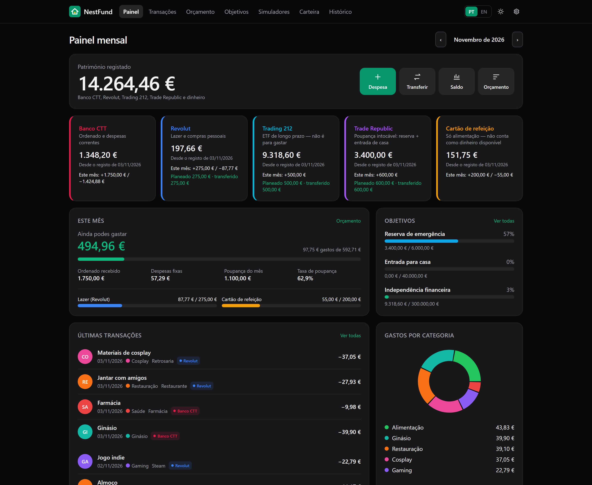
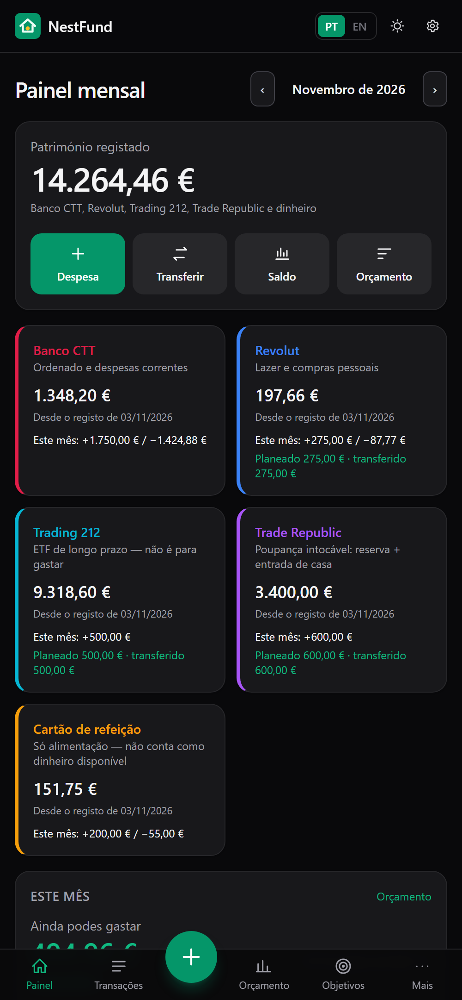
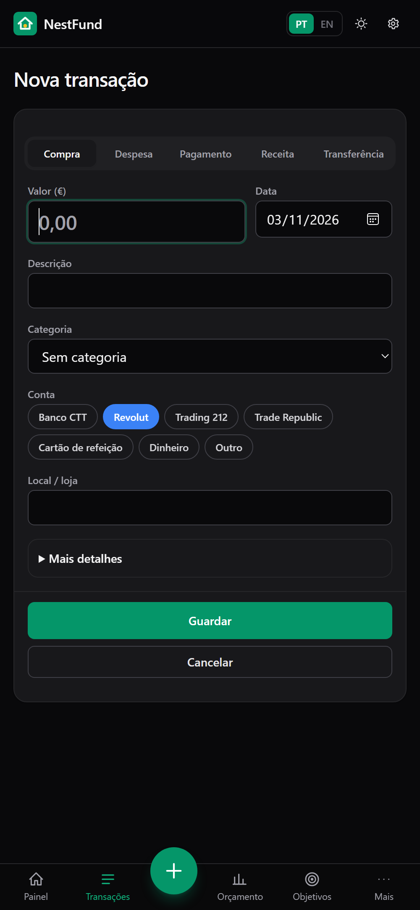
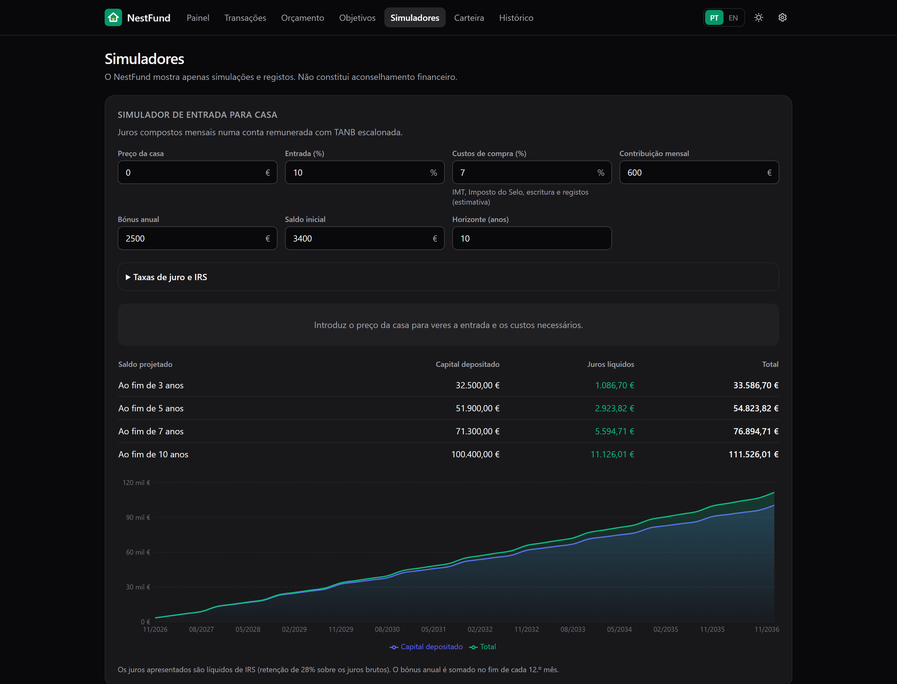

<div align="center">


# NestFund

**As tuas finanças pessoais, num só lugar — orçamento, despesas, objetivos e investimento.**

[](https://github.com/mwmiao/NestFund/actions/workflows/docker-publish.yml)
[](https://hub.docker.com/r/eazyeight/nestfund)

🇵🇹 Português · [🇺🇸 English](README.en-US.md)



</div>

O NestFund é um painel de finanças pessoais self-hosted. Planeia o salário, regista cada compra em segundos e acompanha a poupança, a entrada para casa e o investimento em ETF — sem depender das apps do banco. Os teus dados ficam no teu servidor.

## Funcionalidades

- **Painel claro** — património total, quanto ainda podes gastar este mês e ações rápidas.
- **Contas com propósito** — Banco CTT, Revolut, Trading 212, Trade Republic e cartão de refeição, cada uma com saldo e movimentos.
- **Registo rápido** — compra, despesa, receita ou transferência em poucos toques, com anexos e recorrências.
- **Orçamento mensal** — despesas fixas, lazer, ETF e poupança, planeado vs. real.
- **Objetivos** — reserva de emergência, entrada para casa e independência financeira, com progresso automático.
- **Trading 212 automática** — valor, capital investido e posições sincronizados a cada 6 horas (só leitura).
- **Simuladores** — entrada para casa com TANB escalonada e juros líquidos de IRS; projeção de ETF.
- **Histórico e CSV** — evolução mês a mês, exportação e importação.
- **PT / EN**, modo escuro e pensado para telemóvel.

<div align="center">
  
  &nbsp;
  
</div>

<p align="center"></p>

> O NestFund mostra simulações e registos — não é aconselhamento financeiro.

## Instalar com Docker Compose

```yaml
services:
  nestfund:
    image: eazyeight/nestfund:latest
    container_name: nestfund
    restart: unless-stopped
    ports:
      - "777:777"
    environment:
      TZ: Europe/Lisbon
    sysctls:
      - net.ipv4.ip_unprivileged_port_start=0
    volumes:
      - nestfund-data:/data
    labels:
      - com.centurylinklabs.watchtower.enable=true

volumes:
  nestfund-data:
```

```bash
docker compose up -d
```

Abre `http://<ip-do-servidor>:777` e segue a **Configuração** para introduzir os teus saldos, salário, despesas fixas e objetivos. Podes saltar e voltar mais tarde.

Os dados (SQLite e anexos) ficam no volume `/data`. Para um backup, copia `nestfund.db` com o contentor parado.

## Porto 777 e Cloudflare Tunnel

A app escuta no porto **777**. Para mudar o porto no anfitrião, altera só o lado esquerdo: `"8080:777"`.

Para expor com o Cloudflare Tunnel, adiciona um *Public Hostname* (Zero Trust → Networks → Tunnels):

| Campo | Valor |
|---|---|
| Hostname | `nestfund.o-teu-dominio.pt` |
| Serviço | `HTTP` → `<ip-do-servidor>:777` |

A app não tem contas de utilizador — protege-a com **Cloudflare Access** (política só para o teu e-mail). Em alternativa, define `BASIC_AUTH_USER` e `BASIC_AUTH_PASSWORD`.

## Ligar a Trading 212

1. Na app Trading 212: **Definições › API (Beta)** › gerar chave com permissões só de leitura (*Account data* e *Portfolio*).
2. No NestFund: **Definições › Ligações** › cola a API key e a secret.

O NestFund só lê o resumo da conta e as posições — nunca cria ordens. A chave fica encriptada (AES-256-GCM); define `NESTFUND_SECRET` para usares a tua própria chave de encriptação. Se a ligação falhar, a app continua com os últimos valores.

## Atualização automática com Watchtower

A label `com.centurylinklabs.watchtower.enable=true` permite ao Watchtower atualizar o contentor sempre que sai uma nova imagem `latest`. Os dados mantêm-se e a base de dados é migrada automaticamente no arranque.

## Desenvolvimento

```bash
npm install
npm run dev     # http://localhost:777
npm test
```

Cada push para `main` publica `eazyeight/nestfund:latest` (amd64 + arm64). Uma tag `v1.2.0` publica também `1.2.0`.

## Licença

Projeto pessoal de [@mwmiao](https://github.com/mwmiao). Feito com Next.js, Tailwind CSS e SQLite.
